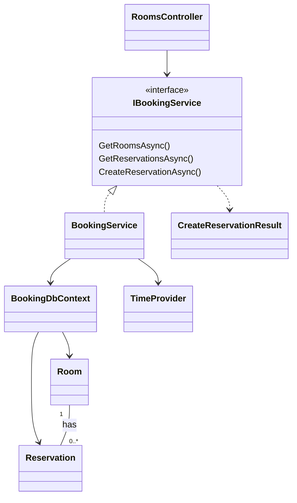
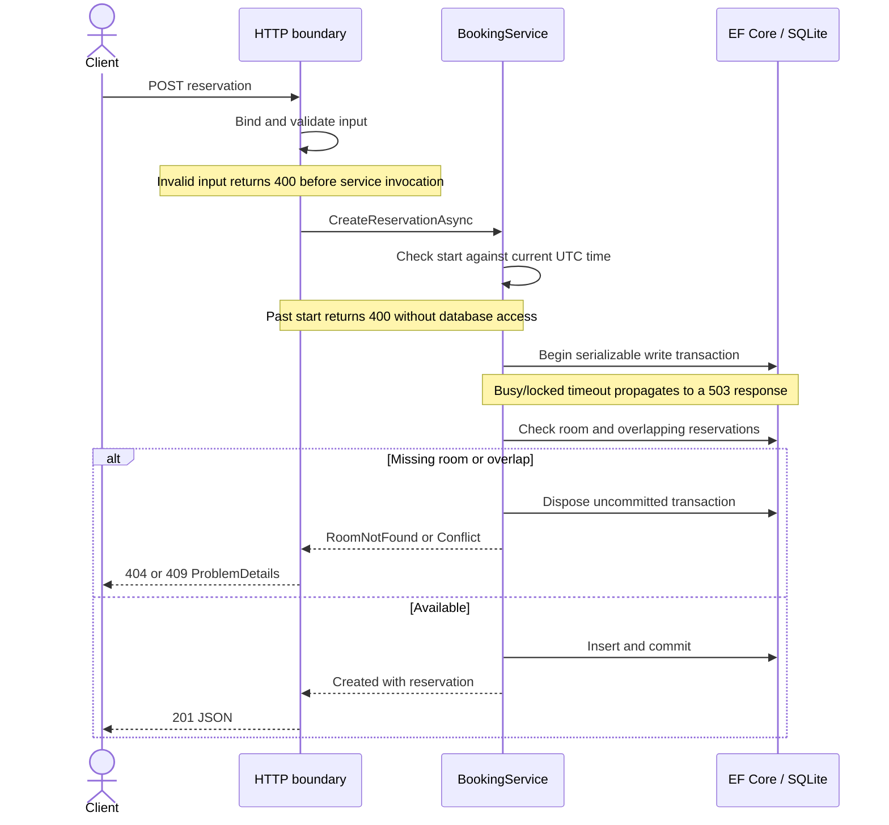
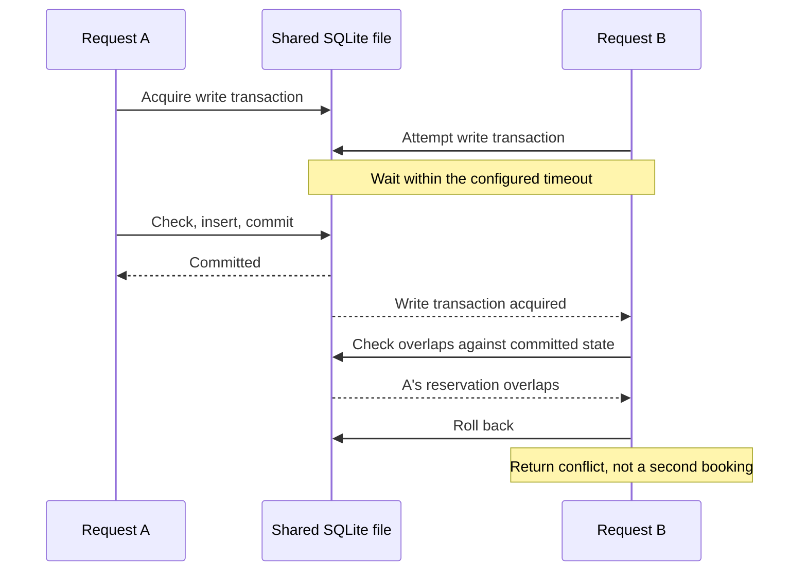

# Room Booking API: MVP Design

This document describes the implemented solution and its trade-offs. For startup
and test commands, see the [README](../README.md). Swagger provides the detailed
request and response schemas.

## 1. Scope and requirement assumptions

The requirement asks for a small .NET 10 REST API backed by local SQLite:
list rooms, query a room's reservations with optional time filtering, and create
reservations without overlaps. It emphasizes readability, validation, conflict
handling, and reasonable query efficiency, not a production-ready platform.

The implementation uses ASP.NET Core controllers and EF Core. Sample rooms are
initialized by a migration. The following interpretations resolve ambiguities;
they are design decisions rather than additional requirements from the assignment.

| Topic | Decision |
|---|---|
| "Available rooms" | List all bookable rooms, not rooms available within a particular time window. |
| Room identity | Each record represents one physical room, not a room category with an inventory count. |
| Reservation filtering | Return reservations that intersect the requested window, including those crossing its boundaries. |
| Optional bounds | Support `from`, `to`, both, or neither. Without bounds, include past and future reservations. |
| Missing room | Return `404`; an existing room with no matching reservations returns `HTTP 200` with empty list. |
| Business restrictions | Reject creation when the start is earlier than the server's current UTC time at validation; equality is allowed. Do not invent opening hours or a maximum duration. |
| Repeated creation | A duplicate time range is a conflict. |

Room administration, reservation updates/cancellation, recurring bookings,
authentication, pagination, and notifications are outside this MVP. Swagger is
a development client, not an end-user booking interface.

## 2. Architecture and responsibilities

The solution has one API project and one test project. Responsibilities are
separated within the API rather than spread across multiple architectural projects.

| Area | Responsibility |
|---|---|
| `Controllers` | Bind and validate HTTP input, call `IBookingService`, and map results to HTTP responses. |
| `Contracts` | Request/response DTOs and the internal `CreateReservationResult` variants. |
| `Services\Interfaces` | Define the three use cases' functionalities within an Interface |
| `Services\Impl` | Implement queries, business checks, creation timestamps, and creation transactions. |
| `Data` | Configure EF Core mappings, constraints, conversions, migrations, and SQLite initialization. |
| `Infrastructure` | Share timestamp parsing between JSON and query binding; produce consistent problem responses. |



`BookingService` and `BookingDbContext` are scoped; a context must not be used
concurrently. `TimeProvider.System` is a singleton dependency that tests can replace
with a fixed clock. Controllers do not query the database or manage transactions.
Database failures or cancellation end the unit of work: dispose the scope and use
a new context for subsequent work. The service does not detach inserted entities
or promise that a failed context can be reused.

`CreateReservationResult` distinguishes `Created`, `RoomNotFound`, and `Conflict`
without encoding HTTP status codes. It is not serialized directly to clients.
Its success branch reuses `ReservationResponse`: this deliberately accepts modest
service/API coupling instead of introducing a duplicate data model.

## 3. API and validation conventions

| Operation | Endpoint | Success |
|---|---|---|
| List rooms | `GET /api/rooms` | `200`, ordered by room ID |
| Query reservations | `GET /api/rooms/{roomId}/reservations?from=...&to=...` | `200`, ordered by start time, then ID |
| Create reservation | `POST /api/rooms/{roomId}/reservations` | `201`, with the created reservation |

Example creation body for room ID `1` in Swagger:

```json
{
  "start": "2026-11-12T10:00:00Z",
  "end": "2026-11-12T11:00:00Z",
  "title": "Project planning"
}
```

### Time and input rules

Reservations and query windows use half-open intervals `[start, end)`. The overlap
predicate for a single room is:

```csharp
existing.StartDateTime < endDateTime &&
existing.EndDateTime > startDateTime
```

Thus `10:00-11:00` conflicts with `10:30-11:30`, but not with `11:00-12:00`.
Filtering applies `EndDateTime > from` and/or `StartDateTime < to` for the
provided bounds; an omitted bound imposes no restriction.

- Room IDs must be positive 32-bit integers. Unparseable or out-of-range IDs return `400`.
- `start`, `end`, and `title` must appear in the JSON body. Start must precede end;
  when both query bounds exist, `from` must precede `to`.
- Creation compares start with `TimeProvider.GetUtcNow()` before database access.
  A past start returns `400` with an `errors.start` entry.
  The clock is read once per valid creation attempt, and that instant is also used
  for the creation timestamp. Equality is allowed; time is not rechecked after lock waits.
  Historical reservation queries remain allowed.
- Input timestamps use ISO 8601 with `Z` or an explicit `+HH:mm` / `-HH:mm`
  offset. Seconds are optional, for example `2026-11-10T10:00Z`. When seconds
  are supplied, fractions use `DateTimeOffset`'s supported precision (up to seven
  digits). The standard exact-format parser rejects invalid dates, missing
  offsets, excess precision, and values outside the representable UTC range.
- JSON and query parameters share one parser. Empty or repeated time query
  parameters are rejected. Encode `+` as `%2B` in query strings.
- Responses use camelCase JSON and UTC timestamps ending in `Z`.
- Titles are trimmed and must contain 1-200 UTF-16 code units after trimming.
  The length limit and strict timestamp format are implementation choices.
- Server-owned IDs and creation timestamps cannot be overridden through the body;
  unknown JSON fields are ignored.

The HTTP boundary validates input before calling the service. The service retains
defensive argument checks for non-HTTP callers. Unexpected `ArgumentException`
failures are not indiscriminately converted into client errors.
The time-dependent past-start rule is checked in the service and returned as a
`StartInPast` result, which the HTTP boundary maps to a field validation error.
Creation returns no `Location` header because the MVP has no single-reservation
GET route. Lists are not paginated or silently truncated.

### Errors and API documentation

Errors use Problem Details. With the default JSON response negotiation,
the content type is `application/problem+json`. Business and exception responses
include `code`, `traceId`, and a request-path `instance`. Framework errors use
ASP.NET Core defaults rather than a custom error-code or field-name mapping.
Validation adds the standard MVC `errors` dictionary: keys can include `Title`,
`$.start`, `$`, or an empty string, as well as action-supplied names such as `start`
and `to`. Clients should use HTTP status, field errors, and business codes where
present, not parse English message text.

| Status | Code | Meaning |
|---|---|---|
| `400` | Framework default (no custom code) | Invalid body, route parameter, or query |
| `404` | `room_not_found` for a missing room; no custom code for routing errors | Missing room / unknown route |
| `405` | Framework default (no custom code) | Unsupported HTTP method |
| `409` | `reservation_conflict` | A reservation overlaps the requested range |
| `415` | Framework default (no custom code) | Unsupported request content type |
| `503` | `database_busy` | SQLite busy/locked failure after bounded waiting |
| `500` | `internal_error` | Unexpected failure, logged without exposing internals |

Known SQLite lock errors, including direct EF update wrappers, are classified by
error code rather than message text. Cancellation is not a reservation conflict.


## 4. Data model, storage, and query efficiency

| Entity | Fields and persistence rules |
|---|---|
| `Room` | Generated integer `Id`, required `Name` (1-100 SQLite characters), and positive `Capacity` |
| `Reservation` | Generated integer `Id`, required `RoomId`, `StartDateTime`, `EndDateTime`, `Title`, and `CreateDateTime` |
| Relationship | `RoomId` references `Rooms.Id`; deleting a room with reservations is restricted |
| Record constraints | Start precedes end; title is required and contains 1-200 SQLite characters |

API `start`, `end`, and `createdAt` map to `StartDateTime`, `EndDateTime`, and
`CreateDateTime`. Creation assigns the timestamp from the clock reading used for
validation; the ORM does not generate it automatically. There is no update
timestamp because this MVP has no update operation.

The migration history was consolidated into one `InitialCreate` while all local
data was disposable. It creates the current schema directly, without intermediate
columns or constraints. Databases from the previous history must be recreated;
there is no upgrade path from those discarded migrations.

### Time representation

HTTP DTOs use `DateTimeOffset`; entities use UTC `DateTime`. An EF value converter
stores .NET ticks as SQLite integers and restores `DateTimeKind.Utc` on reads.
Non-UTC entity writes are rejected rather than interpreted using the machine's
local timezone. Ticks are 100-nanosecond units since the .NET epoch, not Unix time.

This keeps numeric range comparisons predictable despite the SQLite provider's
limitations around default `DateTimeOffset` comparisons. The cost is explicit
conversion code and less readable database values. UTC `DateTime` with the
provider's default mapping is also viable; integer storage is a choice, not a
SQLite requirement. Uniform UTC is an internal convention, not a timezone
management feature requested by the assignment.

Database CHECK constraints supplement application validation. SQLite does not
enforce length solely from EF's `HasMaxLength`; its character counting also differs
from .NET UTF-16 counting. Whitespace-only titles are rejected by the application,
not by database CHECK constraints. UTC and representable time values are enforced
by the application types and converter, not by per-column storage/range checks.
Direct SQL writes must respect these rules. Foreign key enforcement is enabled on configured connections.
These constraints validate records, but do not prevent cross-row time overlaps.

### Queries and indexing

The composite index `(RoomId, StartDateTime)` supports room lookup and start-time
range scans. Conflict checking uses `AnyAsync`, producing an existence query:

```sql
SELECT EXISTS (
    SELECT 1 FROM Reservations
    WHERE RoomId = @roomId
      AND StartDateTime < @end
      AND EndDateTime > @start
);
```

Queries filter and sort in SQL and project response fields without tracking
entities. They do not load a room's entire history to check for conflicts.
However, the end-time predicate can remain a residual filter: the index does not
make arbitrary overlap queries constant-time. Large histories, lower-bound-only
queries, and unbounded responses remain scalability limitations.

### Initialization

EF migrations create the schema and seed three fixed rooms: Small Room (4),
Conference Room (10), and Auditorium (50). Reapplying migrations preserves
reservations and does not reset sample data. `HasData` is appropriate for these
fixed examples; real, environment-specific room inventories should use an
explicit import or administration workflow rather than ongoing migration edits.

Development startup applies migrations before serving requests and fails if
initialization fails. Other environments require explicit migration execution.
Database files and their SQLite sidecar files are excluded from Git.

## 5. Reservation conflicts and transactions

Checking availability and then inserting without a shared transaction allows
two requests to observe the same free slot. A transaction around `SaveChanges`
alone does not protect the earlier check.

The service calls `Database.BeginTransactionAsync(IsolationLevel.Serializable, ...)`
before querying the room or reservations. With the pinned SQLite provider, this
starts a non-deferred write transaction (`BEGIN IMMEDIATE`). All database checks and the
insert use that transaction; success is returned only after commit.





The second diagram assumes A commits within B's wait budget. Otherwise B receives
`503`, not a fabricated `409`. Connection default and command timeouts are five
seconds each, not a five-second total HTTP deadline. The provider handles bounded
lock retries; there is no additional application retry loop.

Uncommitted transactions are disposed on failure or cancellation. If transaction
startup fails, the service explicitly closes the connection reference acquired by
EF because there is no transaction to dispose yet.


**Guarantee boundary:** creation through this protocol against the same database
file cannot commit overlapping reservations. Raw SQL or future write paths that
bypass it can violate the rule. SQLite serializes writers even for different rooms.
Separate database files do not coordinate state, and changing providers requires
revalidating the locking protocol. Read-only queries do not reserve a slot; creation
always checks again. No external network calls run inside the write transaction.

## 6. Test strategy

Tests use xUnit, `WebApplicationFactory`, and real temporary SQLite files rather
than EF Core InMemory. This exercises SQL translation, constraints, transactions,
and the HTTP pipeline together. Test databases are isolated from application data.

| Risk | Coverage |
|---|---|
| Incorrect interval logic | Partial overlaps, containment, equality, adjacency, room isolation, and optional query bounds |
| Invalid HTTP input | Required members, malformed JSON, IDs, title limits, offsets, precision, and consistent JSON/query parsing |
| Persistence errors | Migration reapplication, seed preservation, date precision and UTC round-trips, CHECK constraints, and foreign keys |
| Concurrent creation | Independent connections to one file; competing creates and visibility of another writer's committed reservation |
| Partial writes and resource cleanup | Failure/cancellation after insertion rolls back; resources are released and a fresh context can create a booking |
| Incorrect error contracts | Business conflicts versus real lock timeouts, safe unexpected errors, routing errors, and response fields |
| Review usability | OpenAPI operations and parameter types, Swagger assets, and Development-only exposure |

A fixed `TimeProvider` makes creation-time assertions deterministic. Concurrency
coordination uses signals and interceptors rather than arbitrary sleeps. A gated
first read verifies that the write lock is already held before checking availability.
Lock timeout behavior is tested separately from successful contention.

**These are correctness tests, not load tests.** No throughput or production capacity
claim is made; performance testing was explicitly outside the requirement.

## 7. Current trade-offs and limitations

The main trade-offs are deliberate: a single application keeps the implementation
reviewable; SQLite keeps local setup simple but serializes writes; explicit DTO
mapping avoids a mapping dependency; unpaginated lists keep the requested API small
but allow response size to grow. The MVP lacks authentication and operational
hardening and should not be exposed as a public booking service.

Conflict protection depends on the service transaction and the shared database
file, not a cross-row database constraint. Creation is not idempotent, and update,
cancel, and recurring-booking workflows are not implemented.

See [Platform evolution](platform-evolution.md) for the risks, design choices,
and validation needed to extend this MVP. That document describes future work,
not capabilities already provided by this implementation.

## Appendix: database maintenance and references

`Database:Path` defaults to `App_Data\room-booking.db`, relative to the API content
root. Absolute paths are supported; `Database__Path` overrides the setting.
The parent directory is created automatically. For a non-Windows host, configure
a native path explicitly. The documented local commands use PowerShell.

For manual migration application outside Development, run from the repository root:

```powershell
dotnet tool restore
dotnet ef database update --project .\src\RoomBooking.Api --startup-project .\src\RoomBooking.Api
```

The local tool manifest pins `dotnet-ef` to the project's EF Core version.
After a future mapping change, generate and review a new migration:

```powershell
dotnet ef migrations add MigrationName --project .\src\RoomBooking.Api --startup-project .\src\RoomBooking.Api --output-dir Data\Migrations
dotnet ef migrations has-pending-model-changes --project .\src\RoomBooking.Api --startup-project .\src\RoomBooking.Api
```

Do not mix `EnsureCreated` with migrations. The initial-history reset above is
limited to disposable data; for future changes, preserve migration history and
apply new migrations rather than deleting databases. Back up real data before
upgrades; reverting the initial migration drops the application tables and their data.

- [EF Core transactions](https://learn.microsoft.com/en-us/ef/core/saving/transactions)
- [SQLite provider limitations](https://learn.microsoft.com/en-us/ef/core/providers/sqlite/limitations)
- [Microsoft.Data.Sqlite transactions](https://learn.microsoft.com/en-us/dotnet/standard/data/sqlite/transactions)
- [SQLite locking and timeouts](https://learn.microsoft.com/en-us/dotnet/standard/data/sqlite/database-errors)
- [SQLite async limitations](https://learn.microsoft.com/en-us/dotnet/standard/data/sqlite/async)
- [Pinned provider transaction implementation](https://github.com/dotnet/efcore/blob/v10.0.0/src/Microsoft.Data.Sqlite.Core/SqliteConnection.cs)
